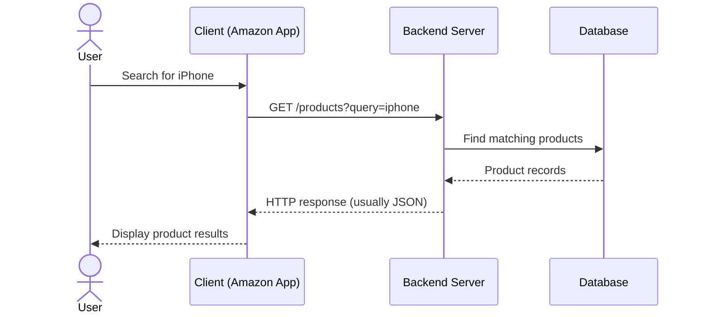
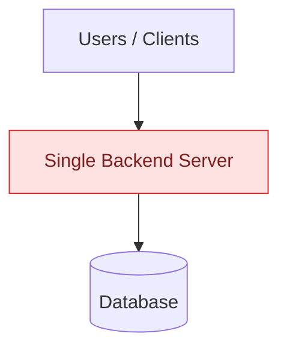
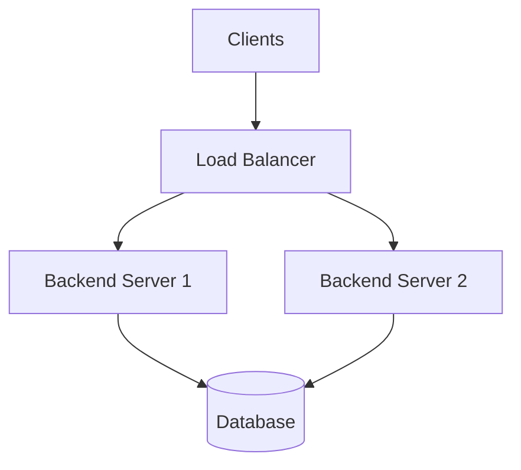
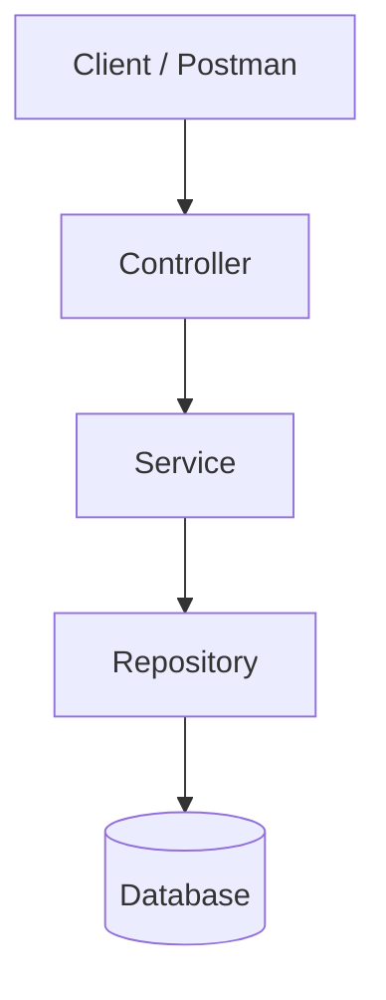

# Topic 01 — Client–Server Architecture

> **System Design | SDE-1 Preparation**  
> Learning style: Tanglish explanations, architecture diagrams, practical scenarios and interview practice.

## 1. What is Client–Server Architecture?

Client–Server Architecture-na, oru application-la **client request anuppum; server andha request-ai receive panni process seithu response return pannum** model.

- **Client:** User interact pannura application — browser, mobile app, Postman.
- **Server:** Request receive panni business logic execute pannura application/server.
- **Database:** Application data store and retrieve pannura system.

**Example:** Amazon app-la iPhone search pannumbodhu, app request anuppum. Backend request process panni product data return pannum. App result-ai user-kku display pannum.

## 2. Basic Request–Response Flow

**Flow in simple words:**

1. User app-la search action perform pannuvaar.
2. Client backend-kku HTTP request anuppum.
3. Server request-ai receive panni validation/business logic execute pannum.
4. Thevai irundha server database query pannum.
5. Database result-ai server-kku return pannum.
6. Server client-kku response anuppum.
7. Client response-ai user-kku display pannum.

**Remember:** Client usually database-ai direct-ah access pannaadhu. Application backend moolama data access pannum.

## 3. Can One Server Handle Multiple Users?

**Yes.** Oru backend server multiple users-oda requests handle panna mudiyum. Threads, concurrency and asynchronous I/O maadhiri mechanisms idharku help pannum.

But server capacity limited. Traffic romba increase aana CPU, memory, connection pool and request queues bottleneck aagalaam. Result: latency increase, timeout, or failed requests.

> One server can handle multiple requests; it cannot handle unlimited traffic.

## 4. What Happens When a Server Fails?

Oru application single backend server mela depend aagirundhu, andha server crash aana, client requests process panna backend available irukkaadhu. Requests fail aagalaam or timeout aagalaam.

Database running-la irundhaalum, client request-ai process panna backend server illai-na application API unavailable-a irukkum.

## 5. SPOF — Single Point of Failure

**Definition:** System-la oru single component fail aana, entire service/application unavailable aagura alavukku dependency irundhaal, andha component is a **Single Point of Failure (SPOF)**.

Example:

Intha architecture-la single backend server fail aana, backend service unavailable aagum.

## 6. Redundancy and Failover

- **Redundancy:** Important component-oda additional instance/backup maintain pannuradhu.
- **Failover:** Active component fail aana, healthy alternative component-kku traffic/workload shift pannuradhu.
- **Health check:** Server healthy-ah irukka-nu periodically check pannuradhu.

Example: Two backend instances + load balancer.

Server 1 fail aana, load balancer health check moolama failure identify panni, new requests-ai healthy Server 2-kku route pannalaam.

**Important trade-off:** Two servers irukkaradhu mattum podhaadhu. Traffic routing and health checks properly configure aaganum. Load balancer or database itself SPOF-aaga irukka koodaadhu; adhaiyum design-la consider pannanum.

## 7. Connection to Java Spring Boot

Spring Boot application-la typical request flow:

- **Controller:** HTTP request receive pannum; response return pannum.
- **Service:** Business logic execute pannum.
- **Repository:** Database operations handle pannum.
- **Database:** Application data store pannum.

Controller, Service, Repository are usually layers/components inside one backend application. Ivai automatically separate servers nu artham illa.

## 8. Key Terms — Quick Revision

| Term | Meaning |
|---|---|
| Client | Request initiate pannura application |
| Server | Request process panni response return pannura system |
| Request | Client server-kku anuppura message |
| Response | Server client-kku return pannura result |
| Concurrency | Multiple tasks overlapping progress-la execute aaguradhu |
| SPOF | Oru component failure service-ai unavailable aakkura risk |
| Redundancy | Backup/additional instances maintain pannuradhu |
| Failover | Failure time-la healthy alternative-kku switch pannuradhu |
| Health check | Component healthy-ah irukka-nu monitor pannuradhu |

## 9. Interview Questions

### Q1. What is Client–Server Architecture?

Client request anuppum; server request process panni response return pannum architecture. Example: browser/mobile app communicating with a backend API.

### Q2. Can one server handle multiple users?

Yes. A server can handle multiple concurrent requests using threads, concurrency and asynchronous processing. Actual capacity depends on resources and workload.

### Q3. What happens if the only backend server crashes?

Backend requests process panna mudiyadhu. Users may receive errors or timeouts. Another healthy instance and proper failover can reduce the outage.

### Q4. What is SPOF?

A single component whose failure can make an important part of the system or the whole service unavailable.

### Q5. How can we reduce backend server SPOF?

Run multiple backend instances, use health checks and a load balancer to route traffic to healthy instances. Also check whether the load balancer and database introduce their own SPOFs.

### Q6. Does the client normally connect directly to the database?

No. Normally client communicates with the backend, and the backend accesses the database. This keeps database credentials and access behind the server-side application.

## 10. 60-Second Interview Explanation

"Client–Server Architecture is a model where a client, such as a browser or mobile app, sends a request to a backend server. The server processes the request, interacts with a database when required, and returns a response to the client. One server can handle multiple requests, but its capacity is limited. If a single backend server is the only instance and it fails, the service can become unavailable — this is a Single Point of Failure. We can reduce this risk with multiple backend instances, health checks and load-balancer-based failover."

## 11. Active Recall — Answer Without Looking

- [ ] Client and server difference enna?
- [ ] Amazon product search request flow draw panna mudiyuma?
- [ ] One server multiple users-ai eppadi handle pannum?
- [ ] Server crash aana enna nadakkum?
- [ ] SPOF-na enna? One example sollu.
- [ ] Redundancy and failover difference enna?
- [ ] Load balancer healthy server-ai eppadi select pannum?
- [ ] Spring Boot-la Controller → Service → Repository flow explain panna mudiyuma?

## 12. Revision Schedule

| When | Revision task | Target time |
|---|---|---:|
| Day 0 | Read once, then explain the flow | 10–15 min |
| Day 1 | Recall definition and draw diagram from memory | 5 min |
| Day 3 | Explain SPOF, redundancy and failover | 5–10 min |
| Day 7 | Answer interview questions without notes | 10 min |
| Day 14 | Explain a server-failure scenario | 10 min |
| Day 30 | Give a 60-second mock interview answer | 5–10 min |

## 13. Interactive Simulation

Simulation source file: `Client_Server_Architecture_Simulation.html` (to be uploaded in this same folder).

**Note:** GitHub repository preview displays Markdown notes directly. It does not run an HTML simulation inside the normal file preview. To open the simulation as an interactive webpage, publish it with GitHub Pages; setup instructions can be added separately.

---

**Status:** Foundation completed. Next topic: HTTP, HTTPS, REST API and DNS.
